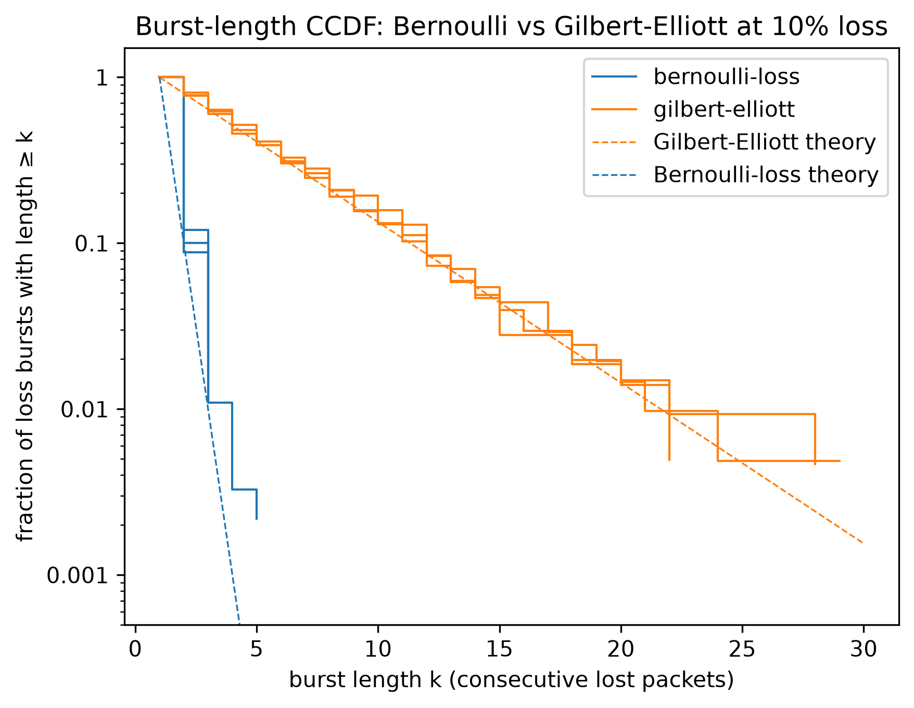

# linkprobe
A codebase that measures what a network does to messages between two machines: round-trip time, packet loss, and how long losses run in a row. It then degrades the link on purpose through five named profiles, one command each. Built for latency-sensitive robotics work, as part of the experimental methodology layer in robotics research.


## Why

When networks transfer packets between machines, they can add delay, lose packets, or drop them in bursts. Many tests and simulations treat each packet loss as independent, at a set rate, because that is the simplest approach (Pieper & Voran, 2023). This is a problem for robotics: real links often lose packets in bursts (Haßlinger & Hohlfeld, 2008), and for a control loop that needs a reply every cycle, a burst means several missed cycles in a row, not one scattered miss.

Burst-loss models such as Gilbert-Elliott already exist, but a model on its own does not show what bursts do to a running system. linkprobe puts a Gilbert-Elliott channel and an independent-loss channel, both at the same 10% loss rate, into a real request/response loop and measures the difference. The goal is to observe what actually happens during packet loss and show that the structure of the losses matters, not just the loss rate.


## Results


At the same 10% loss rate, Gilbert-Elliott bursts averaged 4.4 times longer than Bernoulli bursts (about 4.9 vs 1.1 packets), and the longest burst was 29 packets vs 5, across three seeds.

- [Latency ladder](figures/latency_ladder_titled.png): measured RTT tracks the injected delay with a constant offset of about 5 ms.
- [Deadline sweep](figures/deadline_sweep_titled.png): jitter turns the cliff into a slope:  With a fixed delay, misses fall from 100% to 0 within a few ms of one deadline. With jitter (same ~105 ms median) they fall gradually, and the deadline has to be 176 ms to get misses under 1%.

See [RESULTS.md](RESULTS.md) for the full results.

## What it measures
All experiments ran over loopback on one computer, so the only delay and loss are the ones linkprobe injects.

- Round-trip time per message (how long a packet takes to go from the client to echo server and back)
- Packet sequence gaps (packet loss)
- Run length (how many packets were lost back to back)

Each reply carries its sequence number. The client waits for its own sequence number until that packet's deadline. If no reply comes, the packet is lost. A reply with an older sequence number that shows up later is counted as "late", and it is not credited to the current packet (`echo_client.py`, lines 58 and 75).

## The profiles
A profile sets the type of degradation applied to packets in an experiment.

| Profile | What it does |
| -------- | -------- |
| clean | Baseline: no loss or delay added |
| latency-ladder | A fixed delay, stepped: 0, 50, 100, 150, 200, 250 ms |
| jitter | Varying delay: mean 100 ms, sd 30 ms |
| bernoulli-loss | Packets are dropped independently with probability 10%, a common assumption in network research |
| gilbert-elliott | Losses arrive in bursts: same 10% average loss, but losses come in runs (average ~5 packets )|


## Install

```
git clone https://github.com/AymanM-Projects/linkprobe.git
cd linkprobe
python3 -m venv .venv
.venv/bin/pip install -r requirements.txt
```

Needs Python 3.10 or higher. Matplotlib is only needed for the plotting scripts; everything else uses the standard library.

## Run
Tests (in tests/): 
```
.venv/bin/python -m pytest
```
Figures: 
```
.venv/bin/python plot_burst.py 
.venv/bin/python plot_ladder.py 
.venv/bin/python plot_deadline.py
```
**Warning:** running `run_all.py` overwrites `results/client.log` and adds a second set of CSVs to `results/`. You do not need to re-run it to reproduce the figures, because the plotting scripts read the existing data.

## Status

### Day 1 — Sept 3: setup
Created the README, GitHub repo, and Hackatime and Stardance accounts. Did beginning research on packet loss in networks.

### Day 2 — Sept 13: the measurement loop
- Built `echo_server.py` (UDP, sends every packet straight back unchanged) and `echo_client.py` (sends numbered, timestamped packets). RTT is computed from the send time carried inside the reply, so only the client's clock is ever read and no clock synchronization is needed.
- Added timeout-based loss detection and burst run-length tracking. Verified by killing and restarting the server on purpose: the client recovered bursts of 5 and 8, then 7, 7 and 11.
- Per-packet results saved to CSV in `results/`. Lost packets get an empty RTT, not 0, so they can't pull the average down.
- Finding: baseline RTT depends on send rate (median ~0.06 ms when sending as fast as possible vs ~0.44 ms with a 10 ms gap), so the send interval is now a fixed, recorded parameter.
- Observations: 97,137 packets over loopback with zero loss; latency spikes come in clusters (seqs 16–30) rather than at random; one 14.3 ms stall from the operating system.

### Day 3 — Sept 14: late replies
- Found and fixed a bug where a reply that arrived after the timeout was recorded as the *next* packet's reply, shifting every later measurement by one sequence number. The client now waits for the reply with its own sequence number until a per-packet deadline, and counts replies for older packets as "late". Verified by making the server hold one reply for 1.5 s: 1 lost, 1 late, and every packet after it correct.
- Added total runtime and actual send rate to the summary.
- Cleaned up the repo (`.gitignore`, removed invalid test CSVs).

### Day 4 — Sept 16: impairment models
- Learned the Gilbert-Elliott burst-loss model from Pieper & Voran (2023) and Haßlinger & Hohlfeld (2008).
- Wrote `channel.py`: five profiles (clean, latency-ladder, jitter, bernoulli-loss, gilbert-elliott). Each one answers the same question for every packet — send it back, and after how long? — using its own seeded random generator. Gilbert-Elliott settings are computed from a target loss rate and average burst length (two-parameter model, k = 1, h = 0).
- Generator self-test, 1,000,000 packets each, matched the theory:
  - Bernoulli: loss 9.97%, average burst 1.110 (theory 1.111)
  - Gilbert-Elliott: loss 9.95%, average burst 4.971 (theory 5.0)
  - At the same ~10% loss, bursts of 5 lost packets in a row happened 6 times under Bernoulli and 1,704 times under Gilbert-Elliott.

### Day 5 — Sept 18: first network runs
- Added `config.py` so the client and server always read the same profile, settings and seed. The server now runs every packet through the channel, and CSV filenames record the profile, settings and seed.
- Timeout set to 0.1 s for loss profiles (1.0 s for delay profiles, which must be longer than the largest injected delay).
- First Gilbert-Elliott runs over loopback (two 1,000-packet runs): the client's recorded losses matched the channel's injected drop pattern exactly, packet for packet, across 2,000 packets.
- Found that the server must be restarted before every run: without a restart, the second run continued the seed-1 sequence from packet 1,000 instead of starting over.
- Two 1,000-packet samples of the same 10% channel measured 18.3% and 10.3% loss, so the real runs use 10,000 packets and 3 seeds per model. The cause is variance inflation: Gilbert-Elliott losses come in bursts, so 1,000 packets behave like only about 125 independent samples. The spread is about ±2.7 points at 1,000 packets and ±0.85 at 10,000.

### Day 6 — Sept 19–22: the launcher
- `run_all.py` launcher that starts a fresh server for every run. Settings are passed with argparse through `config.load()`.
- Smoke test, and a first draft of `summary.csv`.

### Day 7 — Sept 23–29: the full experiment
- Ran the full matrix (14 runs, ~55 min).
- Wrote `analyze.py`, which produces `summary.csv` and `burst_lengths.csv`.

### Day 8 — Oct 12–18: write-up and figures
- `requirements.txt` and install steps.
- RESULTS.md, and `verify_replay.py` (59,999 of 60,000 packets matched).
- The burst CCDF figure with theory lines, and the latency-ladder and deadline-sweep figures.


## Citations and Resources
- Haßlinger, G., & Hohlfeld, O. (2008). The Gilbert-Elliott model for packet loss in real time services on the Internet. *14th GI/ITG Conference on Measurement, Modelling and Evaluation of Computer and Communication Systems (MMB 2008)*, Dortmund, Germany. [PDF](https://people.computing.clemson.edu/~jmarty/projects/lowLatencyNetworking/papers/APPFEC/GEModelForLossinTheRTInternet.pdf)
- Pieper, J., & Voran, S. (2023). *Relationships between Gilbert-Elliot burst error model parameters and error statistics* (NTIA Technical Memorandum TM-23-565). National Telecommunications and Information Administration, U.S. Department of Commerce. [PDF](https://its.ntia.gov/umbraco/surface/download/publication?reportNumber=TM-23-565.pdf)


---
Built during the NASA x Hack Club Stardance Challenge, 2026.
