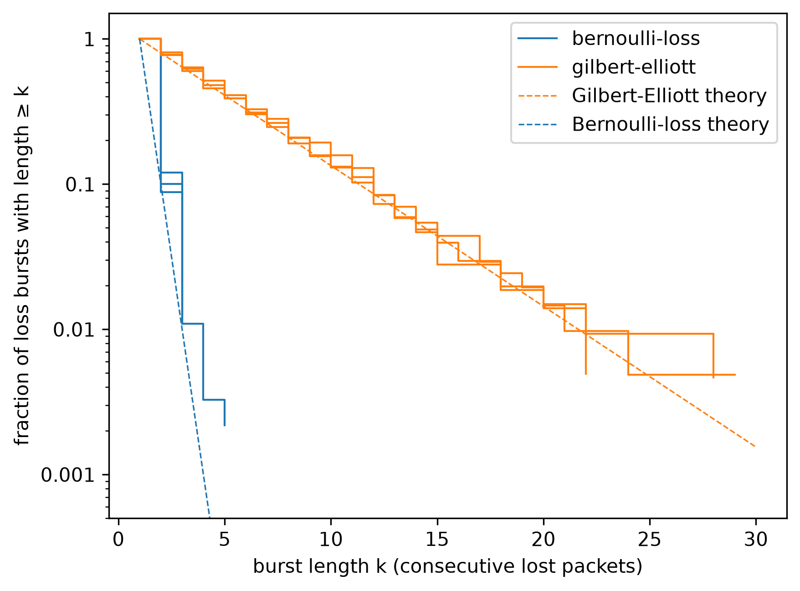

# linkprobe results 

## 1. Headline result

| profile         | loss % (seed 1 / 2 / 3) | mean burst (seed 1 / 2 / 3) | max burst (seed 1 / 2 / 3) |
|-----------------|-------------------------|-----------------------------|----------------------------|
| bernoulli-loss  | 10.41 / 10.09 / 9.79    | 1.136 / 1.099 / 1.113       | 5 / 3 / 3                  |
| gilbert-elliott | 10.30 / 10.18 / 9.93    | 4.791 / 4.966 / 4.916       | 28 / 29 / 22               |

Both profiles lose about 10% of packets. Gilbert-Elliott's mean burst is 4.4 times Bernoulli's. This holds across all three seeds. The longest Gilbert-Elliott burst was 29 packets and the longest Bernoulli burst was 5.
Burst length matters so much in a control loop, even though both profiles have about the same loss percentage, because the network is down for longer periods of time.

## 2. Noise floor: the clean baseline

The clean run sent 10,000 packets and recorded 3 as lost. All 3 were replies that arrived after the 0.1 s timeout, for sequence numbers 4465, 4469, and 4546. The number of packets truly dropped was 0.
With nothing additionally injected, the program drops zero packets, so in the trial runs essentially every lost packet is one the injector dropped on purpose, and the instrument's own error is about 3 in 10,000.

## 3. The clean p99

The clean run's median round-trip time was 0.394 ms and its p99 was 7.366 ms, at 0.03% loss. The 0 ms latency-ladder run, which uses the same loopback path, had a p99 of 1.809 ms.

## 4. Injector validation

Gilbert-Elliott was configured for a mean burst of 5 packets. Measured end to end over the network, the three seeds gave 4.791, 4.966, and 4.916.
This proves the configuration for the Gilbert-Elliott pipeline accurately emulates our configured mean burst in the data.

## 5. Deadline_MS

The deadline of 50 ms in analyze.py is an arbitrary deadline amount.

## 6. Replay check

## 7. Limitations

