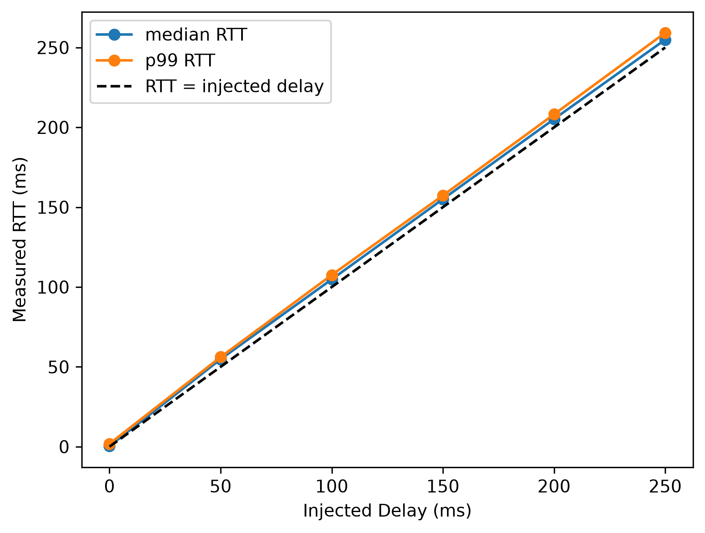
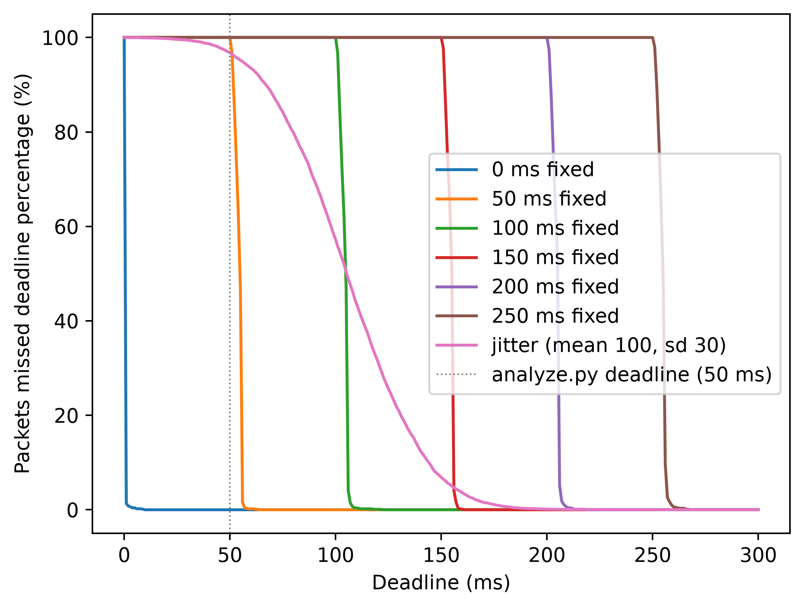

# linkprobe results 
14 runs (10,000 packets each, except 1,000 per latency-ladder rung) ran over loopback on one MacBook, sending one packet every 10 ms. The timeout was 0.1 s for the loss runs and 1.0 s for the delay runs. Each loss profile was run with 3 seeds (random-generator starting values) to show that the results repeat.

## 1. Headline result

| profile         | loss % (seed 1 / 2 / 3) | mean burst (seed 1 / 2 / 3) | max burst (seed 1 / 2 / 3) |
|-----------------|-------------------------|-----------------------------|----------------------------|
| bernoulli-loss  | 10.41 / 10.09 / 9.79    | 1.136 / 1.099 / 1.113       | 5 / 3 / 3                  |
| gilbert-elliott | 10.30 / 10.18 / 9.93    | 4.791 / 4.966 / 4.916       | 28 / 29 / 22               |

Both profiles lose about 10% of packets. Gilbert-Elliott's mean burst is 4.4 times Bernoulli's. This holds across all three seeds. The longest Gilbert-Elliott burst was 29 packets and the longest Bernoulli burst was 5.
At one packet every 10 ms, a 29-packet burst is about 290 ms with no replies, while the worst Bernoulli burst (5 packets) is about 50 ms. A control loop would be blind for that whole stretch, even though the two profiles have the same loss %.
Burst length matters in a control loop because the network is effectively down for longer periods of time.

Each curve shows the fraction of bursts that were at least N packets long, and the dashed lines are the theoretical values. A curve that stays high further to the right means longer bursts.

## 2. Noise floor: the clean baseline

The clean run sent 10,000 packets and recorded 3 as lost. All 3 were replies that arrived after the 0.1 s timeout, for sequence numbers 4465, 4469, and 4546. The number of packets truly dropped was 0.
With nothing additionally injected, the program drops zero packets, so in the trial runs essentially every lost packet is one the injector dropped on purpose, and the instrument's own error is about 3 in 10,000.

## 3. The clean p99

The clean run's median round-trip time was 0.394 ms and its p99 was 7.366 ms, at 0.03% loss. The 0 ms latency-ladder run, which uses the same loopback path, had a p99 of 1.809 ms.
The 7.366 ms p99 does not come from the link, because loopback has no physical link. The most likely cause is the operating system briefly pausing the client and server processes. For about 10 seconds of the run 
(54 s to 64 s, sequence numbers 4243 to 4547), replies were repeatedly slow. All three timed-out packets from section 2 fall inside that window, and so do 14 of the 16 replies that took longer than 50 ms.

## 4. Injector validation

Gilbert-Elliott was configured for a mean burst of 5 packets. Measured end to end by the client, the three seeds gave 4.791, 4.966, and 4.916.
All three seeds are within sampling noise of the configured 5. Each run has about 200 bursts, and burst lengths with a mean of 5 have a spread (standard deviation) of about 4.5 packets, so the sampling noise on the mean is about 4.5 / √200 ≈ ±0.3. The injector produces the burst length it was configured for.

## 5. The 50 ms deadline

The deadline of 50 ms in `analyze.py` is an arbitrary deadline amount. 50 was chosen as a single placeholder treshold for the summary table. Section 8 checks every deadline from 0 to 300 aswell.
This deadline is used by `analyze.py` to calculate `deadline_miss_pct` and `over_deadline`. A later deadline-sweep (section #8) figure will use many different deadlines instead of just this one.

## 6. Replay check

In `verify_replay.py`, I used each run's seed to rebuild its channel and compared the channel's decisions, packet by packet, to the `lost` column in each run's CSV. Across all 6 runs (3 Bernoulli, 3 GE) and 60,000 packets sent, 59,999 matched. The one difference was a late packet (GE seed 2, seq 8409), not a drop caused by the injector. The channel delivered it, but the reply arrived after the 0.1 s timeout, so the client marked it as lost (`results/client.log` line 48445).

To reproduce: `.venv/bin/python verify_replay.py`

## 7. Latency ladder

`plot_ladder.py` plots six runs with a fixed injected delay of 0 to 250 ms, 1,000 packets each. The dashed line is y = x, where the measured RTT would exactly equal the injected delay.

| injected delay (ms) | median RTT (ms) | p99 RTT (ms) | median − injected (ms) |
|---------------------|-----------------|--------------|------------------------|
| 0                   | 0.352           | 1.809        | 0.35                   |
| 50                  | 54.800          | 56.132       | 4.80                   |
| 100                 | 104.807         | 107.558      | 4.81                   |
| 150                 | 155.050         | 157.344      | 5.05                   |
| 200                 | 205.213         | 208.148      | 5.21                   |
| 250                 | 254.933         | 259.243      | 4.93                   |

At every nonzero rung, the median sits 4.8 to 5.2 ms above the injected delay, and the p99 is only 1.3 to 4.3 ms above the median, so a fixed delay has almost no spread. The offset stays the same as the delay grows, so the injector adds the right amount of delay plus a constant offset. The 0 ms rung's median is only 0.35 ms, so loopback is not the cause. The most likely cause is the server oversleeping in `time.sleep()`, but this has not been measured directly.

## 8. Deadline sweep

With the single 50 ms deadline from section 5, every nonzero ladder rung shows a `deadline_miss_pct` of 100%, because even the smallest delay (50 ms, measured at 54.8 ms) is above the deadline. One deadline cannot tell these runs apart.

`plot_deadline.py` reads each run's per-packet CSV and computes the percentage of packets slower than every deadline from 0 to 300 ms. Lost packets count as a miss at every deadline. No new data was collected.

- **Fixed delay (a cliff):** each curve stays at 100% and then drops almost straight down about 5 ms after its injected delay.
- **Jitter (a slope):** the curve falls gradually and crosses 50% near its median RTT of about 105 ms.

| deadline (ms) | 100 ms fixed: missed (%) | jitter: missed (%) |
|---------------|--------------------------|--------------------|
| 50            | 100                      | 96.78              |
| 100           | 100                      | 57.26              |
| 110           | 0.4                      | 43.53              |
| 150           | 0                        | 6.89               |
| 200           | 0                        | 0.13               |

The 100 ms fixed run and the jitter run have about the same median RTT (104.8 ms and 105.2 ms). At a 110 ms deadline, the fixed run misses 0.4% and misses nothing past 122 ms. The jitter run misses 43.53% at 110 ms and needs a 176 ms deadline to get under 1%. This is the same idea as section 1: the spread of the delay matters, not just its average. A fixed delay can be planned around. With jitter, the controller has to choose between a long deadline (slow reactions) and frequent misses.

Two details in the jitter run: one packet took 581 ms, and only 2 of 10,000 took longer than 250 ms, so it is a single outlier, most likely the same kind of operating-system pause as in section 3. Three packets took under 5 ms, because `channel.py` (line 45) clips negative random delays to 0.

## 9. Limitations

- The p99 only counts the round-trip time (RTT) of packets that were delivered. Lost packets have no RTT, so a run with many lost packets could still show a good p99. It is important to read this value alongside the loss %.
- The latency ladder and the jitter run each used only one seed, so there are no repeated trials for them.
- The client-server loop only has impairment on one leg rather than both. Impairment can only happen on the server side, after it receives the packet from the client and before it replies. This means the client-to-server leg is always clean. In real applications, packets can be lost in both directions, so the round-trip loss could be higher. 
- All runs were over loopback only, with no real network or wireless link, so the only impairment is the one linkprobe injects. Future work could repeat these runs over a network of several computers.
- The 10% loss and 5-packet mean burst were picked to make a clear comparison. They were not fitted to a real robot link.
- Only burst length was measured, not robot behavior. The claim that a control loop would go blind is reasoning from the burst data; it has not been tested with a real robot or robot network.
